<div align="center">


# Cocos Challenge

**Una app de broker en React Native: mercado, portfolio y órdenes, en español e inglés, con tema claro y oscuro.**

Hecha para el [desafío React Native de Cocos Capital](https://github.com/cocos-capital/cocos-challenge/blob/main/react-native-challenge.md).

[](https://github.com/steppannws/cocos-challenge/actions/workflows/ci.yml)


[English](README.md) · **Español**

Traducción de [`README.md`](README.md). Si hay diferencias, vale la versión en inglés.

[Funciones](#funciones) · [Capturas](#capturas) · [Cómo correrla](#cómo-correrla) · [Decisiones técnicas](#decisiones-técnicas) · [Limitaciones](#limitaciones)

<br />

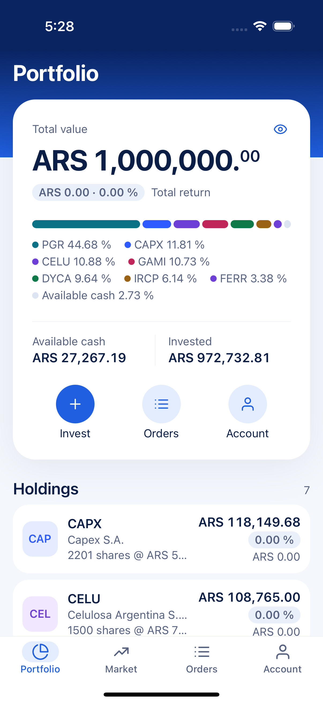&nbsp;&nbsp;
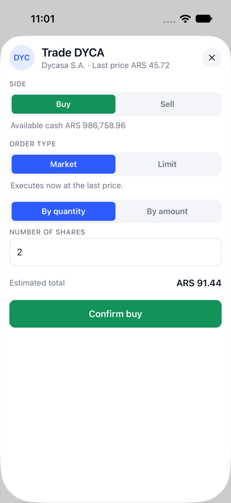&nbsp;&nbsp;
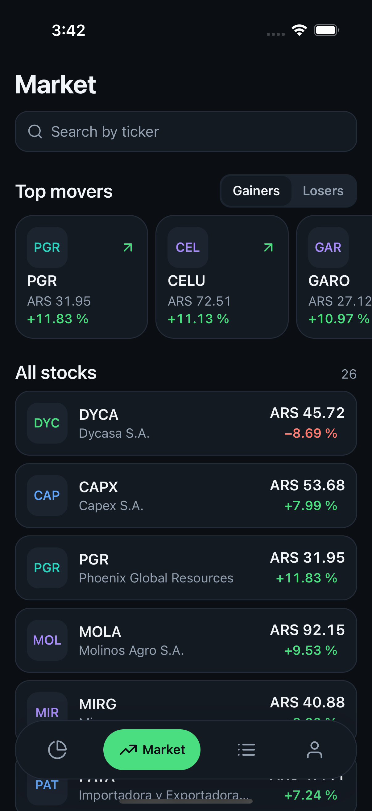

</div>

## Funciones

- **Mercado**: la lista de instrumentos con una fila de "Mayores movimientos", y búsqueda por ticker.
- **Portfolio**: valor de mercado, resultado y rendimiento de cada tenencia, más el efectivo, los totales y una barra de distribución.
- **Órdenes**: BUY y SELL, MARKET o LIMIT, por cantidad o por monto en ARS, con el estado en vivo de cada orden.
- **Lecturas offline**: los últimos datos se abren sin conexión; las órdenes nunca se encolan.
- **Tema claro y oscuro**, español e inglés.

**Stack**: React Native 0.88 bare (New Architecture, Hermes) · TypeScript strict · TanStack Query · zustand · zod · i18next · MMKV · Vitest · Maestro.

## Capturas

| Portfolio | Mercado | Búsqueda |
|---|---|---|
|  | 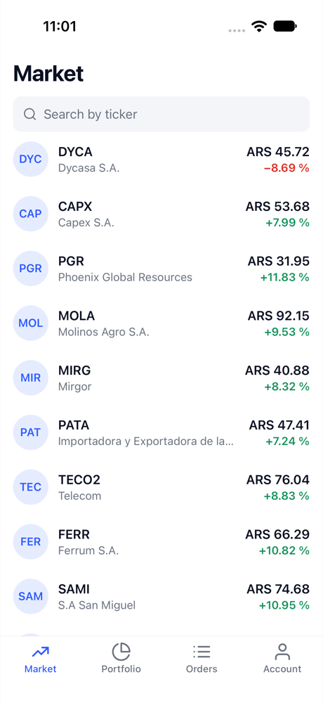 | 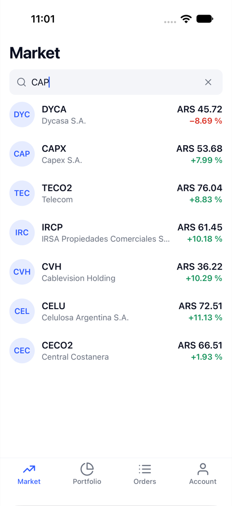 |

| Formulario de orden | Resultado de la orden | Órdenes | Detalle de orden |
|---|---|---|---|
|  | 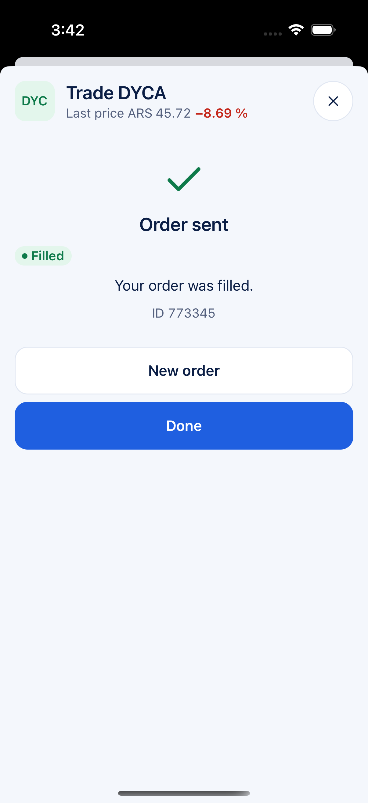 | 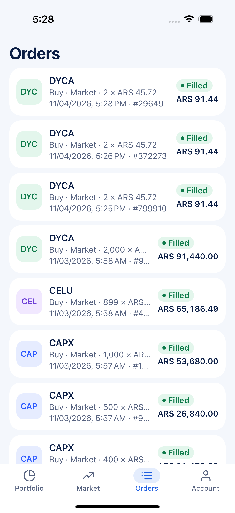 | 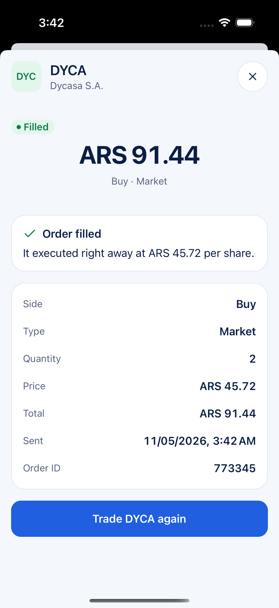 |

Modo oscuro (Cuenta → Modo oscuro; mientras no se elija, la app sigue la apariencia del teléfono):

| Portfolio | Mercado | Formulario de orden | Órdenes | Cuenta |
|---|---|---|---|---|
| 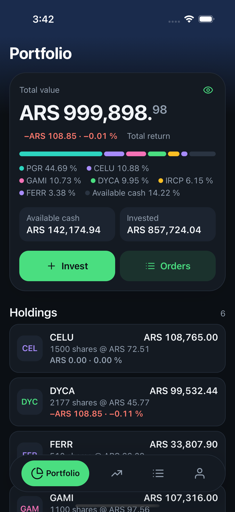 |  | 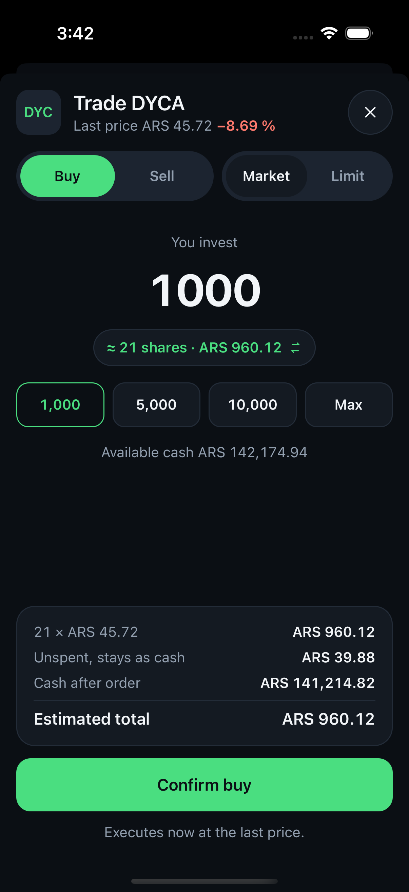 | 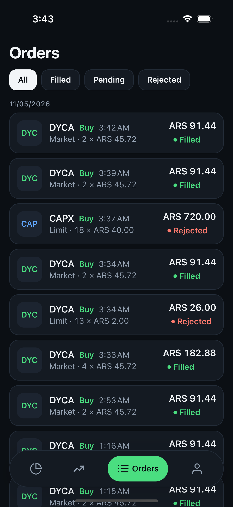 | 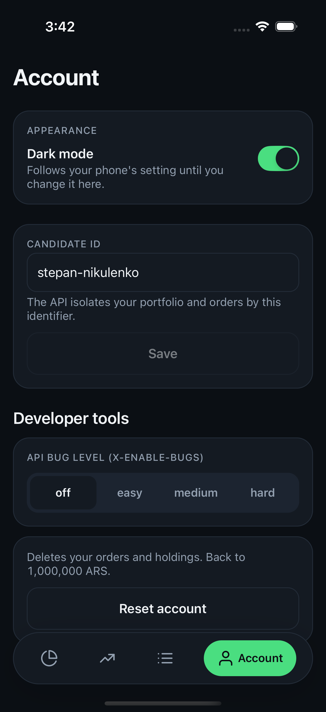 |

Las capturas salen del simulador de iPhone 16 Pro (iOS 18.2). El flujo de Maestro `.maestro/tour.yaml` toma las del tema claro.

## Requisitos y dónde viven

| Requisito del desafío | Pantalla | Código |
|---|---|---|
| `/instruments`: ticker, nombre, último precio, rendimiento diario | Tab **Mercado**, con una fila de "Mayores movimientos" | `src/screens/MarketScreen`. `dailyReturn` y `topMovers` en `src/utils/portfolio.ts` calculan los valores. |
| `/search?query=` por ticker | Caja de búsqueda en el tab Mercado. La búsqueda espera 300 ms después de la última tecla y deja los resultados anteriores en pantalla mientras carga. | `useMarketList` en `src/screens/MarketScreen/hooks` |
| `/portfolio`: ticker, cantidad, valor de mercado, resultado, rendimiento total | Tab **Portfolio**, el primero. También muestra el efectivo, el valor invertido, los totales y una barra de distribución. | `holdingMetrics`, `portfolioTotals` y `portfolioAllocation` en `src/utils/portfolio.ts` |
| `POST /orders` desde un modal: operación, tipo, cantidad **o** monto en ARS, precio para LIMIT. Mostrar el `id` y el `status` que devuelve la API. | **Formulario de orden**. Se abre al tocar un instrumento o una tenencia. | `src/screens/OrderSheetScreen`. La lógica del formulario es una función pura en `orderForm.ts`. |
| Extra: historial de órdenes con el estado en vivo de las órdenes LIMIT `PENDING` | Tab **Órdenes**. Consulta la API cada 15 s mientras haya una orden pendiente. | `useOrders` en `src/hooks/useOrders.ts` |
| Extra: detalle de orden con una explicación del estado | Modal **Detalle de orden**. Se abre al tocar una orden. | `src/screens/OrderDetailScreen` |
| Extra: una cuenta por candidato, el nivel de bugs de la API y un reinicio de cuenta, para QA | Tab **Cuenta**. El nivel de bugs y el reinicio solo aparecen en builds de debug. | `src/screens/AccountScreen`, `src/store/session.ts` |
| Extra: tema claro y oscuro | Tab **Cuenta**, switch Modo oscuro. La elección persiste; sin una elección, la app sigue la apariencia del sistema. | `src/theme` (`palettes.ts`, `useTheme.ts`), `themePreference` en `src/store/session.ts` |
| Extra: filtros de órdenes y montos rápidos | **Órdenes** filtra por estado y agrupa por día. El **formulario de orden** tiene atajos (+1/+10/+100/Máx acciones, 1.000/5.000/10.000/Máx ARS) y un resumen con el efectivo que queda después de la orden. | `groupByDay` en `src/utils/orders.ts`, `quickPicks` en `orderForm.ts` |

## Cómo correrla

Hace falta:

- Node 22 o superior,
- pnpm 11 (`npm i -g pnpm@11`; el campo `packageManager` de `package.json` fija la versión exacta),
- Xcode 16 o superior, con CocoaPods vía Bundler (Ruby 2.7 o superior),
- Android Studio con JDK 17 o superior y un AVD.

```bash
pnpm install          # también activa el hook de pre-commit de git
pnpm pods             # iOS: bundle exec pod install
pnpm start            # Metro
pnpm ios              # o: pnpm android
```

La configuración está en `.env`. El archivo está en git porque solo tiene valores públicos:

```
API_URL=https://dummy-api-topaz.vercel.app
CANDIDATE_ID=stepan-nikulenko   # X-Candidate-Id: la API guarda un portfolio por valor. El tab Cuenta puede cambiarlo.
SENTRY_DSN=                     # vacío = reporte de crashes apagado
```

La API también exige el header `X-Enable-Bugs`. La app manda `off`, que da el comportamiento correcto de la API. En un build de debug, el tab Cuenta puede cambiar el valor a `easy`, `medium` o `hard`. La API entonces inyecta defectos y se puede ver cómo los maneja la UI. Un build de release siempre manda `off`.

## Chequeos

```bash
pnpm verify        # typecheck + lint + 66 tests unitarios (el hook de pre-commit también lo corre)
pnpm verify:full   # verify + bundles de release para ambas plataformas + chequeo del bundle de dev (CI corre esto)
scripts/run-app.sh ios .maestro/tour.yaml   # simulador + build de debug + flujo de Maestro + capturas en artifacts/screenshots/
```

Flujos de Maestro:

- `smoke.yaml`: la app arranca y muestra el tab Mercado.
- `tour.yaml`: búsqueda, una compra MARKET, el portfolio, la lista de órdenes y el detalle de orden.
- `limit-order.yaml`: una compra LIMIT por monto, un error de validación y el resultado `PENDING`. Necesita un candidato sin acciones de CAPX (antes, "Reiniciar cuenta" desde el tab Cuenta).

## Decisiones técnicas

[`docs/decisions.es.md`](docs/decisions.es.md) da una línea por cada elección. Esta sección explica las más importantes.

### La respuesta del servidor es la única copia de los datos del servidor

- Las respuestas de la API viven en **TanStack Query** y en ningún otro lado. Todas las query keys están en `src/api/queryKeys.ts`. Las keys de los datos por candidato incluyen el candidate id. Así, un cambio de cuenta dispara un fetch nuevo y nunca muestra la caché de otro candidato.
- Cada valor en pantalla es una **función pura de una respuesta**. `dailyReturn`, `holdingMetrics`, `portfolioTotals`, `portfolioAllocation`, `topMovers` y `maxSharesForAmount` (`src/utils`) corren dentro de `useMemo`. Los tests unitarios los verifican con los números del desafío.
- El formulario de orden es el ejemplo más claro. Las cinco entradas (operación, tipo, modo cantidad o monto, valor, precio límite) y los datos de mercado entran a una sola función, `deriveOrder`. Devuelve la cantidad a enviar, el precio, el total estimado y todos los errores de validación. La pantalla muestra ese objeto. El estado del componente no guarda una segunda copia de "cantidad" ni de "isValid". Los 13 tests de `orderForm.test.ts` cubren el formulario completo sin renderizar.
- El **estado de cliente** es solo el candidate id y el nivel de bugs de debug. Un store chico de zustand los guarda en MMKV.

### El dinero está en centavos enteros

La API manda los precios como pesos en float (`45.72`). Los esquemas zod en `src/schemas` los convierten a centavos enteros y pasan los nombres de snake_case a camelCase. Esto ocurre una sola vez, en el borde con la API. Ninguna otra parte de la app ve un precio en float ni un nombre de campo de la API.

`formatMoney` y `formatPercent` son los únicos formateadores. Usan `Intl` con el locale del idioma de la UI. El código agrega el signo `+` por su cuenta, porque Hermes en Android no soporta la opción `signDisplay` de `Intl` en todos los dispositivos.

### Manejo de errores

- **Un solo punto de entrada HTTP**: `request()` en `src/api/client.ts`. Agrega los headers requeridos y un timeout de 15 s. Parsea el body y lo valida con el esquema zod del llamador. Si falla, lanza un `ApiError` de uno de estos tipos:
  - `network`: sin conexión.
  - `timeout`: sin respuesta en 15 s.
  - `http`: un status 4xx o 5xx. El error contiene el texto de la API, por ejemplo "Insufficient cash".
  - `shape`: una respuesta 200 con un body que no coincide con el esquema.

  Una regla de lint prohíbe `fetch` en cualquier otro archivo.
- **Reintentos**: una lectura reintenta dos veces después de un error `network`, un `timeout` o un status 5xx. No reintenta después de un 4xx ni de un error `shape`. **Una orden nunca reintenta.** La API no tiene claves de idempotencia, así que un segundo `POST /orders` crea una segunda orden.
- **Estados de UI**: cada lista usa `QueryStateView` para los estados de carga, error (con botón de reintentar) y vacío, y soporta pull-to-refresh. El formulario de orden muestra el error de la API en el formulario y conserva los valores que escribió el usuario. Un `ErrorBoundary` raíz muestra una pantalla de reintento en lugar de una pantalla blanca y manda el error a Sentry. Sin DSN, Sentry no manda nada.
- **Logs**: `console.*` es un error de lint. `src/utils/logger.ts` es el único logger.
- **Offline**: la app guarda la caché de lecturas en MMKV durante 7 días. Así, los tabs abren con los últimos datos y un banner de sin conexión. La app **no** encola órdenes mientras está offline. Es intencional, ver [`docs/offline.es.md`](docs/offline.es.md). El botón de enviar está deshabilitado mientras el dispositivo está offline y mientras hay un request en curso.
- **Validación en el borde**: si la lista de instrumentos llega con una forma incorrecta, la pantalla muestra un solo error `shape` con un botón de reintentar. No muestra `NaN` en una fila. Con el nivel de bugs en `hard` se puede ver.

### Organización de componentes

- Una carpeta de pantalla `src/screens/<Name>Screen/` contiene la pantalla, su `styles.ts`, y los `hooks/` y `components/` que solo usa esa pantalla (por ejemplo `useMarketList`, `InstrumentRow`, `MoverCard`, `HeaderBand`).
- `src/components/` contiene los bloques compartidos: `Text`, `Button`, `SegmentedControl`, `TextField`, `QueryStateView`, `StatusChip`, `DeltaText`, `Icon` y otros. Un componente pasa a `src/components` solo cuando una segunda pantalla lo necesita.
- Los estilos usan tokens tipados de `src/theme` a través de `StyleSheet.create`. `src/theme/palettes.ts` define una paleta clara y una oscura con las mismas claves. Cada `styles.ts` envuelve su hoja en `makeStyles((colors) => StyleSheet.create(...))`, que arma las dos hojas una sola vez al importar; el hook `useStyles` que devuelve elige la activa, así que cambiar de tema no cuesta trabajo de estilos. Estos son **errores de lint**: un color hex fuera del theme, un objeto de estilo inline, un string crudo en JSX y un touchable sin props de accesibilidad. Otra regla de lint limita cada pantalla a 400 líneas.
- La navegación usa React Navigation: cuatro tabs (Portfolio, Mercado, Órdenes, Cuenta) en una tab bar flotante tipo píldora (`src/navigation/FloatingTabBar.tsx`), y un native stack. El stack tiene dos rutas modales: el formulario de orden y el detalle de orden. Los parámetros de ruta contienen solo ids. Las pantallas leen precios, tenencias y órdenes de la caché de queries.

### Estrategia de testing

- **Vitest en Node, solo para lógica** (66 tests). Los tests cubren la matemática de dinero, los valores derivados, el formulario de orden y los esquemas zod. También cubren el cliente HTTP con un `fetch` mockeado: headers, cada tipo de error, timeout y abort.
- `tests/platform.test.ts` lee archivos fuente y encuentra errores que solo ocurren en un dispositivo. Por ejemplo: i18n tiene que ser el primer import, el placeholder de cleartext traffic tiene que seguir en el manifest de Android, y cada clave de env tiene que estar en `.env`.
- **Maestro** prueba las pantallas. `scripts/run-app.sh` arranca un simulador, compila la app de debug si hace falta, corre un flujo y guarda las capturas en una ruta fija. El proyecto no tiene snapshot tests: se rompen con cada cambio visual y prueban poco.
- `pnpm verify` corre en el hook de pre-commit (`.githooks/pre-commit`, con gitleaks cuando está instalado). GitHub Actions corre `pnpm verify:full`.

### Internacionalización

El español es el idioma por defecto, porque los precios están en ARS. El inglés tiene las mismas claves. El tipo de las claves sale de `es.json`, así que una clave faltante es un error de `tsc`. Los plurales usan las formas `_one` y `_other` de i18next.

## Limitaciones

Son límites conocidos. Algunos vienen de la API y otros son decisiones de alcance.

- **No se pueden cancelar órdenes.** La API no tiene un endpoint para cancelar una orden `PENDING`.
- **Sin motivo de rechazo.** La API no dice por qué rechazó una orden. El detalle de orden lista las causas habituales y no elige una.
- **Sin precios en tiempo real.** Los precios cambian solo cuando la app los vuelve a pedir (pull-to-refresh, foco de la app, reconexión). Solo la lista de órdenes hace polling, y solo mientras hay una orden `PENDING`.
- **Sin órdenes offline.** Ver [`docs/offline.es.md`](docs/offline.es.md).
- **Sin paso de confirmación.** Una orden MARKET va a la API cuando el usuario toca enviar. El precio puede ser distinto del precio en pantalla.
- **Solo acciones enteras.** Una orden por monto en ARS manda la mayor cantidad entera de acciones que ese monto compra al último precio (MARKET) o al precio límite (LIMIT). La app no soporta fracciones de acciones.
- **Sin login.** El candidate id identifica la cuenta. Cualquiera que conozca un id puede usar esa cuenta.
- **Sin layout para tablet.** El proyecto de iOS permite iPad, pero nadie probó el layout en una tablet.
- **El modo oscuro se probó solo en iOS.** Falta revisar en un dispositivo la tab bar flotante sobre la barra de navegación de Android y los colores de la status bar de Android.
- **Sin pipeline de release.** CI corre los chequeos y compila los bundles de JS. No firma ni sube un build. Maestro no corre en CI. [`docs/production-checklist.es.md`](docs/production-checklist.es.md) lista el trabajo que necesita un release a las tiendas.
- **Pocos tests de pantalla.** Tres flujos de Maestro cubren los caminos principales en iOS. Los estados de error no tienen test automático. Los niveles de bugs sirven para probarlos a mano.

## Notas sobre la API

Son observaciones del desarrollo. El nivel de bugs era `off` salvo que una línea diga otra cosa.

- Cada endpoint necesita el header `X-Enable-Bugs`. `/portfolio`, `/orders` y `/reset` también necesitan `X-Candidate-Id`. La consigna de React Native no menciona estos headers. La consigna de QA del mismo repositorio los documenta.
- El portfolio es `{ cash, holdings[] }` por candidato. La API lo calcula a partir de las órdenes `FILLED` y resta el efectivo reservado por las órdenes `PENDING`. Una tenencia no tiene `name`. La app toma el nombre de la lista de instrumentos en caché.
- `POST /orders` devuelve `201` para una orden MARKET y `200` en algunos niveles de bugs. La app solo chequea `ok`. Un body 4xx es `{ "error": "..." }`, y la app muestra ese texto sin cambios.
- En el nivel `easy`, el portfolio puede estar desactualizado. En el nivel `hard`, una orden MARKET se ejecuta a `close_price` en lugar de `last_price`. Estos niveles son buenas entradas para probar los estados de error.

## Próximos pasos

- Un paso de confirmación con una advertencia cuando cambia el precio.
- Cancelación de órdenes LIMIT `PENDING` (necesita un endpoint nuevo en la API).
- Una pantalla de detalle de instrumento con un gráfico de precio.
- Precios en tiempo real.
- Un pipeline de release (fastlane o EAS) con source maps, y los ítems de [`docs/production-checklist.es.md`](docs/production-checklist.es.md).
- Maestro en CI sobre un simulador.

## Estructura del proyecto

```
App.tsx                      i18n primero, reporte de crashes, providers, error boundary, navegador
src/
  navigation/                RootNavigator.tsx (tabs + stack modal), types.ts
  screens/                   PortfolioScreen · MarketScreen · OrdersScreen · OrderSheetScreen · OrderDetailScreen · AccountScreen
  components/                UI compartida: Text, Button, SegmentedControl, TextField, Card, Screen, QueryStateView, ...
  api/                       client.ts (el único fetch), queryClient.ts (persistencia, online/foco), queryKeys.ts, <recurso>Api.ts
  schemas/                   zod: forma cruda de la API → forma de la app (camelCase, centavos)
  hooks/                     useInstruments, usePortfolio, useOrders, useIsOnline, useLocale, ...
  utils/                     money.ts, format.ts, portfolio.ts, orders.ts, errors.ts, logger.ts (+ tests)
  store/session.ts           zustand: candidate id, nivel de bugs
  offline/storage.ts         instancia de MMKV detrás de la caché de queries y del store
  i18n/                      index.ts, claves tipadas, locales/es.json, locales/en.json
  theme/index.ts             colores, espaciados, radios, tamaños de fuente
  config/env.ts              react-native-config, validado una vez con zod
tests/platform.test.ts       chequeos a nivel de fuente para supuestos que solo valen en dispositivo
.maestro/                    smoke.yaml, tour.yaml, limit-order.yaml
scripts/                     verify.sh, run-app.sh, setup-hooks.sh
docs/                        decisions.md, offline.md, production-checklist.md (y sus traducciones .es.md)
AGENTS.md                    reglas de trabajo para humanos y agentes de IA en este repo
```
