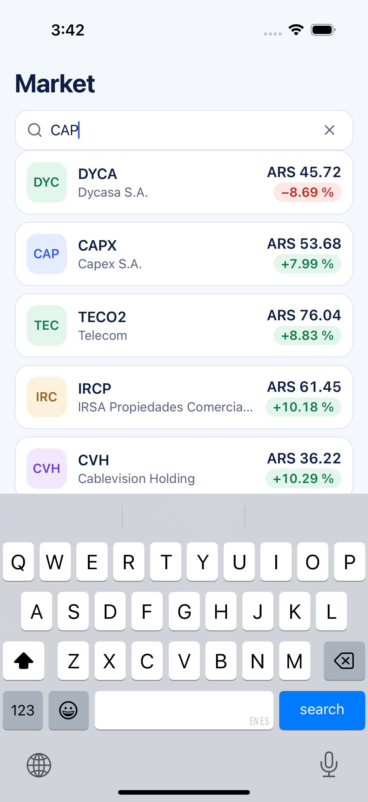
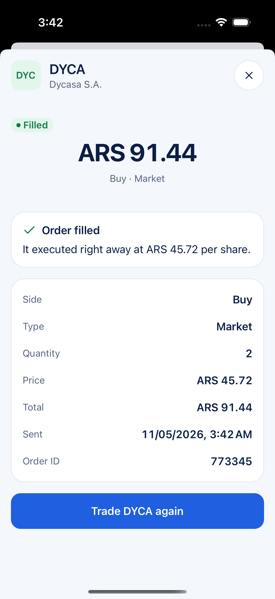
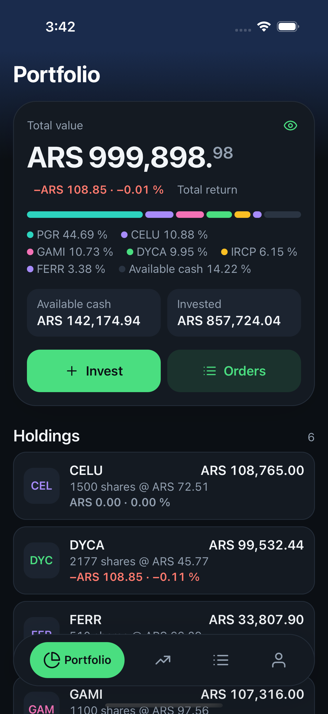
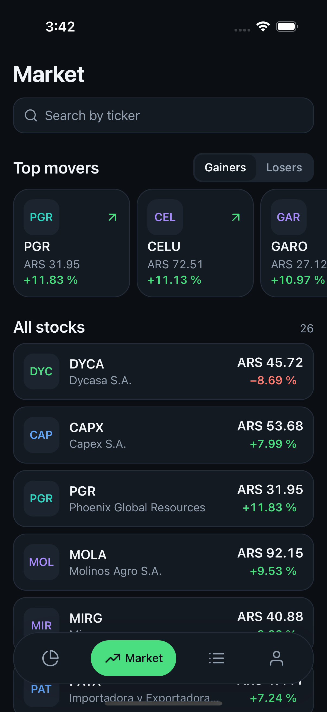
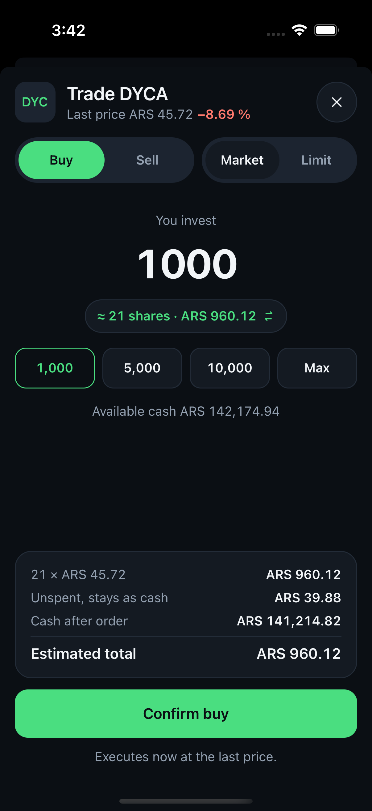
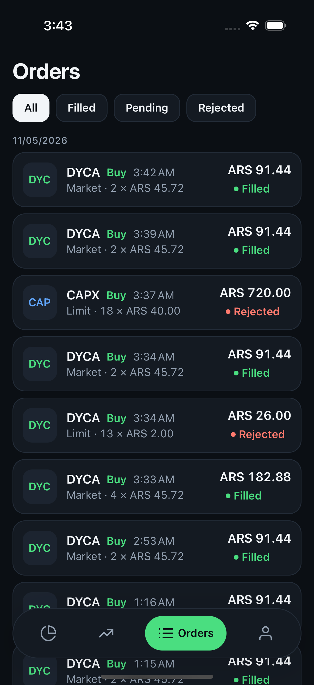
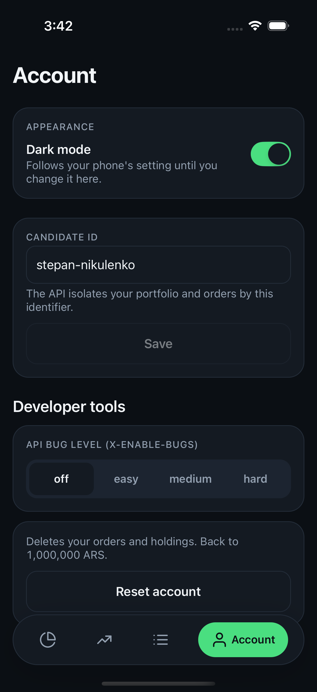

# Cocos Challenge

A broker app for the [Cocos Capital React Native challenge](https://github.com/cocos-capital/cocos-challenge/blob/main/react-native-challenge.md). The user can:

- see the instrument list and search it by ticker,
- see the portfolio with market value, P&L and return,
- send BUY and SELL orders (MARKET or LIMIT, by quantity or by ARS amount),
- follow the status of each order,
- switch between a light and a dark theme.

Stack: bare React Native 0.88 (New Architecture, Hermes), TypeScript strict, TanStack Query, zustand, zod, i18next (Spanish and English).

| Portfolio | Market | Search |
|---|---|---|
|  |  |  |

| Order sheet | Order result | Orders | Order detail |
|---|---|---|---|
|  |  |  |  |

Dark mode (Account → Dark mode; until then the app follows the phone's appearance):

| Portfolio | Market | Order sheet | Orders | Account |
|---|---|---|---|---|
|  |  |  |  |  |

The screenshots come from the iPhone 16 Pro simulator (iOS 18.2). The Maestro flow in `.maestro/tour.yaml` takes the light ones.

## Requirements and where they live

| Challenge requirement | Screen | Code |
|---|---|---|
| `/instruments`: ticker, name, last price, daily return | **Market** tab, with a "Top movers" row | `src/screens/MarketScreen`. `dailyReturn` and `topMovers` in `src/utils/portfolio.ts` calculate the values. |
| `/search?query=` by ticker | Search box on the Market tab. The search waits 300 ms after the last key and keeps the previous results on screen while it loads. | `useMarketList` in `src/screens/MarketScreen/hooks` |
| `/portfolio`: ticker, quantity, market value, P&L, total return | **Portfolio** tab, the first tab. It also shows cash, invested value, totals and an allocation bar. | `holdingMetrics`, `portfolioTotals` and `portfolioAllocation` in `src/utils/portfolio.ts` |
| `POST /orders` from a modal: side, type, quantity **or** ARS amount, price for LIMIT. Show the `id` and `status` that the API returns. | **Order sheet**. Tap an instrument or a holding to open it. | `src/screens/OrderSheetScreen`. The form logic is one pure function in `orderForm.ts`. |
| Extra: order history with the live status of `PENDING` LIMIT orders | **Orders** tab. It polls every 15 s while an order is pending. | `useOrders` in `src/hooks/useOrders.ts` |
| Extra: order detail with an explanation of the status | **Order detail** modal. Tap an order to open it. | `src/screens/OrderDetailScreen` |
| Extra: one account per candidate, the API bug level and an account reset, for QA | **Account** tab. The bug level and the reset show only in debug builds. | `src/screens/AccountScreen`, `src/store/session.ts` |
| Extra: light and dark theme | **Account** tab, Dark mode switch. The choice persists; without one the app follows the system appearance. | `src/theme` (`palettes.ts`, `useTheme.ts`), `themePreference` in `src/store/session.ts` |
| Extra: order filters and quick amounts | **Orders** filters by status and groups by day. The **order sheet** has quick picks (+1/+10/+100/Max shares, 1,000/5,000/10,000/Max ARS) and a summary with the cash left after the order. | `groupByDay` in `src/utils/orders.ts`, `quickPicks` in `orderForm.ts` |

## Run it

You need:

- Node 22 or later,
- pnpm 11 (`npm i -g pnpm@11`, the `packageManager` field in `package.json` pins the exact version),
- Xcode 16 or later, with CocoaPods through Bundler (Ruby 2.7 or later),
- Android Studio with JDK 17 or later and one AVD.

```bash
pnpm install          # also enables the git pre-commit hook
pnpm pods             # iOS: bundle exec pod install
pnpm start            # Metro
pnpm ios              # or: pnpm android
```

The configuration is in `.env`. The file is in git because it holds public values only:

```
API_URL=https://dummy-api-topaz.vercel.app
CANDIDATE_ID=stepan-nikulenko   # X-Candidate-Id: the API keeps one portfolio per value. The Account tab can change it.
SENTRY_DSN=                     # empty = crash reporting is off
```

The API also requires the `X-Enable-Bugs` header. The app sends `off`, which gives correct API behavior. In a debug build, the Account tab can change the value to `easy`, `medium` or `hard`. The API then injects defects, and you can see how the UI handles them. A release build always sends `off`.

## Checks

```bash
pnpm verify        # typecheck + lint + 54 unit tests (the pre-commit hook runs it too)
pnpm verify:full   # verify + release bundles for both platforms + a dev-bundle check (CI runs this)
scripts/run-app.sh ios .maestro/tour.yaml   # simulator + debug build + Maestro flow + screenshots in artifacts/screenshots/
```

Maestro flows:

- `smoke.yaml`: the app starts and shows the Market tab.
- `tour.yaml`: search, a MARKET buy, the portfolio, the orders list and the order detail.
- `limit-order.yaml`: a LIMIT buy by amount, a validation error, and the `PENDING` result. It needs a candidate with no CAPX shares (use "Reset account" first).

## Technical decisions

[`docs/decisions.md`](docs/decisions.md) gives one line for each choice. This section explains the most important ones.

### The server response is the only copy of server data

- API responses live in **TanStack Query** and in no other place. All query keys are in `src/api/queryKeys.ts`. Keys for per-candidate data contain the candidate id. Thus a change of account starts a new fetch and never shows the cache of a different candidate.
- Each value on the screen is a **pure function of a response**. `dailyReturn`, `holdingMetrics`, `portfolioTotals`, `portfolioAllocation`, `topMovers` and `maxSharesForAmount` (`src/utils`) run inside `useMemo`. Unit tests check them with the numbers from the challenge.
- The order sheet is the clearest example. The five inputs (side, type, quantity or amount mode, value, limit price) and the market data go into one function, `deriveOrder`. It returns the quantity to send, the price, the estimated total and all validation errors. The screen shows that object. Component state holds no second copy of "quantity" or "isValid". The 13 tests in `orderForm.test.ts` cover the full form without a render.
- **Client state** is the candidate id and the debug bug level only. A small zustand store keeps them in MMKV.

### Money is in integer cents

The API sends prices as float pesos (`45.72`). The zod schemas in `src/schemas` change them to integer cents and change snake_case names to camelCase. This happens once, at the API boundary. No other part of the app sees a float price or an API field name.

`formatMoney` and `formatPercent` are the only formatters. They use `Intl` with the locale of the UI language. The code adds the `+` sign itself, because Hermes on Android does not support the `Intl` option `signDisplay` on all devices.

### Error handling

- **One HTTP entry point**: `request()` in `src/api/client.ts`. It adds the required headers and a 15 s timeout. It parses the body and validates it with the zod schema of the caller. On failure it throws an `ApiError` with one of these kinds:
  - `network`: no connection.
  - `timeout`: no response in 15 s.
  - `http`: a 4xx or 5xx status. The error contains the text from the API, for example "Insufficient cash".
  - `shape`: a 200 response with a body that does not match the schema.

  A lint rule forbids `fetch` in all other files.
- **Retries**: a read retries two times after a `network` error, a `timeout` or a 5xx status. A read does not retry after a 4xx status or a `shape` error. **An order never retries.** The API has no idempotency keys, so a second `POST /orders` makes a second order.
- **UI states**: each list uses `QueryStateView` for the loading, error (with a retry button) and empty states, and supports pull-to-refresh. The order sheet shows the API error in the form and keeps the values that the user typed. A root `ErrorBoundary` shows a retry screen instead of a white screen, and sends the error to Sentry. Without a DSN, Sentry sends nothing.
- **Logging**: `console.*` is a lint error. `src/utils/logger.ts` is the only logger.
- **Offline**: the app stores the read cache in MMKV for 7 days. Thus the tabs open with the last data and an offline banner. The app does **not** queue orders while it is offline. This is intentional, see [`docs/offline.md`](docs/offline.md). The submit button is disabled while the device is offline and while a request is in progress.
- **Validation at the boundary**: if the instrument list has a bad shape, the screen shows one `shape` error with a retry button. It does not show `NaN` on one row. Set the bug level to `hard` to see this.

### Component organization

- A screen folder `src/screens/<Name>Screen/` holds the screen, its `styles.ts`, and the `hooks/` and `components/` that only this screen uses (for example `useMarketList`, `InstrumentRow`, `MoverCard`, `HeaderBand`).
- `src/components/` holds the shared building blocks: `Text`, `Button`, `SegmentedControl`, `TextField`, `QueryStateView`, `StatusChip`, `DeltaText`, `Icon` and others. A component moves to `src/components` only when a second screen needs it.
- Styles use typed tokens from `src/theme` through `StyleSheet.create`. `src/theme/palettes.ts` defines a light and a dark palette with the same keys. Each `styles.ts` wraps its sheet in `makeStyles((colors) => StyleSheet.create(...))`, which builds both sheets once at import; the `useStyles` hook it returns picks the active one, so a theme switch costs no style work. These are **lint errors**: a hex color outside the theme, an inline style object, a raw string in JSX, and a touchable without accessibility props. A lint rule also limits each screen to 400 lines.
- Navigation uses React Navigation: four tabs (Portfolio, Market, Orders, Account) in a floating pill tab bar (`src/navigation/FloatingTabBar.tsx`), and a native stack. The stack has two modal routes: the order sheet and the order detail. Route params contain ids only. The screens read prices, holdings and orders from the query cache.

### Testing strategy

- **Vitest in Node, for logic only** (54 tests). The tests cover money math, derived values, the order form and the zod schemas. They also cover the HTTP client with a mock `fetch`: headers, each error kind, timeout and abort.
- `tests/platform.test.ts` reads source files and finds errors that occur only on a device. For example: i18n must be the first import, the cleartext-traffic placeholder must stay in the Android manifest, and each env key must be in `.env`.
- **Maestro** tests the screens. `scripts/run-app.sh` starts a simulator, builds the debug app if necessary, runs a flow and saves the screenshots at a fixed path. The project has no snapshot tests: they break on each visual change and prove little.
- `pnpm verify` runs in the pre-commit hook (`.githooks/pre-commit`, with gitleaks when it is installed). GitHub Actions runs `pnpm verify:full`.

### Internationalization

Spanish is the default language, because the prices are in ARS. English has the same keys. The key type comes from `es.json`, so a missing key is a `tsc` error. Plurals use the i18next `_one` and `_other` forms.

## Limitations

These are known limits. Some come from the API and some are scope choices.

- **No order cancel.** The API has no endpoint to cancel a `PENDING` order.
- **No rejection reason.** The API does not say why it rejected an order. The order detail lists the usual causes and does not select one.
- **No real-time prices.** Prices change only when the app fetches them again (pull-to-refresh, app focus, reconnect). Only the orders list polls, and only while an order is `PENDING`.
- **No offline orders.** See [`docs/offline.md`](docs/offline.md).
- **No confirmation step.** A MARKET order goes to the API when the user taps submit. The price can be different from the price on the screen.
- **Whole shares only.** An order by ARS amount sends the largest whole number of shares that the amount can buy at the last price. The app does not support fractional shares.
- **No login.** The candidate id identifies the account. Any person who knows an id can use that account.
- **No tablet layout.** The iOS project allows iPad, but nobody tested the layout on a tablet.
- **Dark mode was checked on iOS only.** The floating tab bar over the Android navigation bar and the Android status bar colors still need a pass on a device.
- **No release pipeline.** CI runs the checks and builds the JS bundles. It does not sign or upload a build. Maestro does not run in CI. [`docs/production-checklist.md`](docs/production-checklist.md) lists the work that a store release needs.
- **Few screen tests.** Three Maestro flows cover the main paths on iOS. The error states have no automatic test. Use the bug levels to check them manually.

## Notes on the API

These are observations from development. The bug level was `off` unless a line says something different.

- Each endpoint needs the `X-Enable-Bugs` header. `/portfolio`, `/orders` and `/reset` also need `X-Candidate-Id`. The React Native brief does not mention these headers. The QA brief in the same repository documents them.
- The portfolio is `{ cash, holdings[] }` for each candidate. The API calculates it from the `FILLED` orders and subtracts the cash reserved by `PENDING` orders. A holding has no `name`. The app gets the name from the cached instrument list.
- `POST /orders` returns `201` for a MARKET order and `200` at some bug levels. The app checks only `ok`. A 4xx body is `{ "error": "..." }`, and the app shows that text without changes.
- At the `easy` level, the portfolio can be out of date. At the `hard` level, a MARKET order fills at `close_price` instead of `last_price`. These levels are good inputs to test the error states.

## Next steps

- A confirmation step with a warning when the price changes.
- Cancel for `PENDING` LIMIT orders (this needs a new API endpoint).
- An instrument detail screen with a price chart.
- Real-time prices.
- Dark mode.
- A release pipeline (fastlane or EAS) with source maps, and the items in [`docs/production-checklist.md`](docs/production-checklist.md).
- Maestro in CI on a simulator.

## Project structure

```
App.tsx                      i18n first, crash reporting, providers, error boundary, navigator
src/
  navigation/                RootNavigator.tsx (tabs + modal stack), types.ts
  screens/                   PortfolioScreen · MarketScreen · OrdersScreen · OrderSheetScreen · OrderDetailScreen · AccountScreen
  components/                shared UI: Text, Button, SegmentedControl, TextField, Card, Screen, QueryStateView, ...
  api/                       client.ts (the only fetch), queryClient.ts (persistence, online/focus), queryKeys.ts, <resource>Api.ts
  schemas/                   zod: raw API shape → app shape (camelCase, cents)
  hooks/                     useInstruments, usePortfolio, useOrders, useIsOnline, useLocale, ...
  utils/                     money.ts, format.ts, portfolio.ts, orders.ts, errors.ts, logger.ts (+ tests)
  store/session.ts           zustand: candidate id, bug level
  offline/storage.ts         MMKV instance behind the query cache and the store
  i18n/                      index.ts, typed keys, locales/es.json, locales/en.json
  theme/index.ts             colors, spacing, radii, font sizes
  config/env.ts              react-native-config, validated once with zod
tests/platform.test.ts       source-level checks for device-only assumptions
.maestro/                    smoke.yaml, tour.yaml, limit-order.yaml
scripts/                     verify.sh, run-app.sh, setup-hooks.sh
docs/                        decisions.md, offline.md, production-checklist.md
AGENTS.md                    working rules for humans and AI agents in this repo
```
