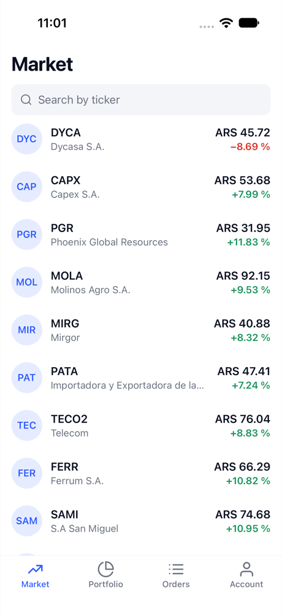
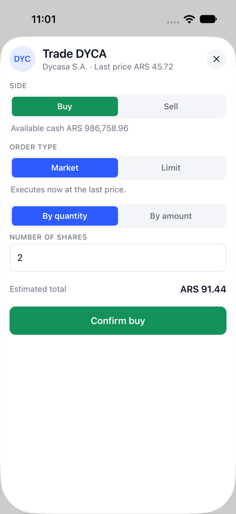
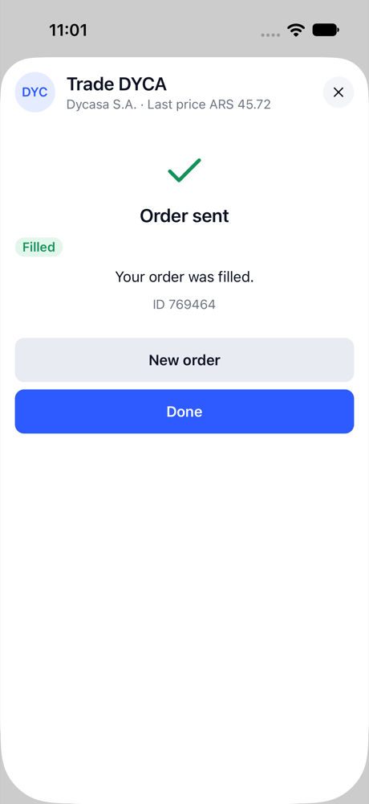
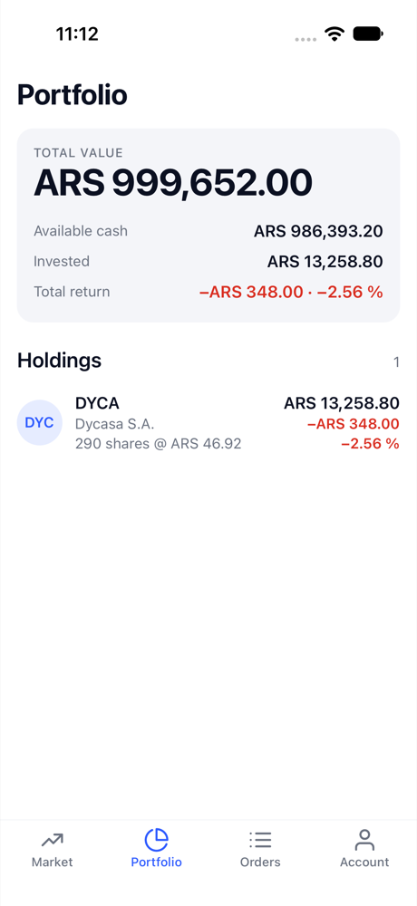
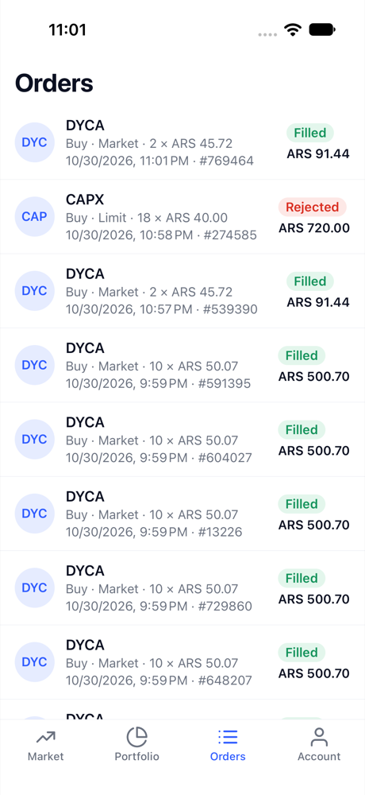
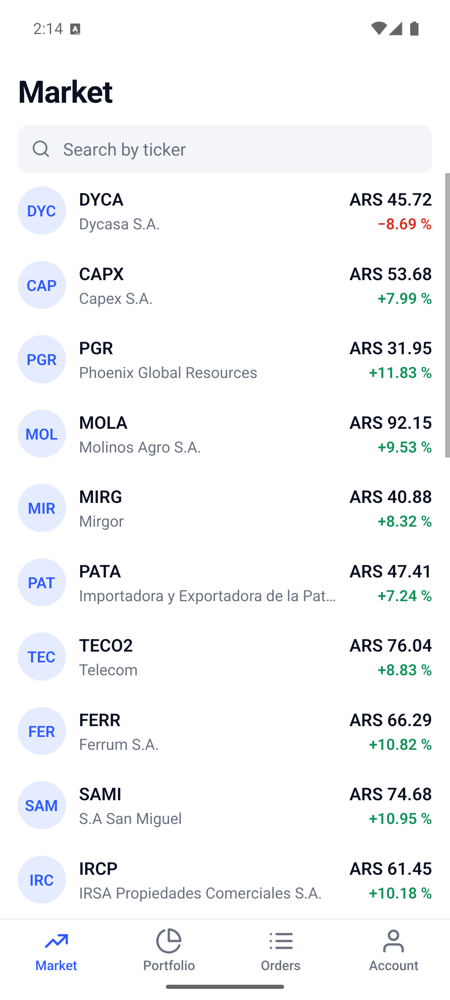
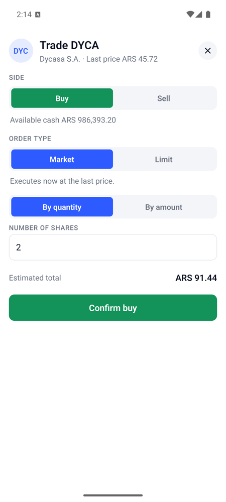

# Cocos Challenge

A small broker app for the [Cocos Capital React Native challenge](https://github.com/cocos-capital/cocos-challenge/blob/main/react-native-challenge.md): browse instruments, search by ticker, see your portfolio, send BUY/SELL orders (MARKET or LIMIT, by quantity or by ARS amount) and follow their status.

Bare React Native 0.88 (New Architecture, Hermes), TypeScript strict, TanStack Query, zustand, zod, i18next (es/en). No Expo.

| Market | Order sheet | Result | Portfolio | Orders |
|---|---|---|---|---|
|  |  |  |  |  |

Verified on iPhone 17 (iOS 27 simulator) and a Pixel-class Android 15 emulator: `pnpm verify:full` green, Maestro flows `smoke`, `tour` and `limit-order` passing on iOS, `smoke` and `tour` on Android.

| Android: Market | Android: Order sheet |
|---|---|
|  |  |

## Requirements → where they live

| Challenge requirement | Screen | Code |
|---|---|---|
| `/instruments`: ticker, name, last price, daily return | **Market** tab | `src/screens/MarketScreen`, return computed by `dailyReturn` in `src/utils/portfolio.ts` |
| `/search?query=` by ticker | Market search box (debounced, keeps previous results while typing) | `useMarketList` in `src/screens/MarketScreen/hooks` |
| `/portfolio`: ticker, quantity, market value, P&L, total return | **Portfolio** tab (plus cash, invested and totals) | `holdingMetrics` / `portfolioTotals` in `src/utils/portfolio.ts` |
| `POST /orders` from a modal: side, type, quantity **or** ARS amount, price for LIMIT; show returned `id` + `status` | **Order sheet** (tap any instrument or holding) | `src/screens/OrderSheetScreen`, pure logic in `orderForm.ts` |
| Extra: order history with live status for `PENDING` LIMIT orders | **Orders** tab (polls every 15 s while something is pending) | `useOrders` in `src/hooks/useOrders.ts` |
| Extra: per-candidate account, API bug level and reset for QA | **Account** tab (dev tools only in debug builds) | `src/screens/AccountScreen`, `src/store/session.ts` |

## Run it

Requirements: Node ≥ 22, pnpm 11 (`npm i -g pnpm@11`; the `packageManager` field pins the exact version), Xcode 16+ with CocoaPods through Bundler (Ruby ≥ 2.7), Android Studio with JDK 17+ and one AVD.

```bash
pnpm install          # also enables the git pre-commit hook
pnpm pods             # iOS: bundle exec pod install
pnpm start            # Metro
pnpm ios              # or: pnpm android
```

Configuration lives in `.env` (committed, public values only):

```
API_URL=https://dummy-api-topaz.vercel.app
CANDIDATE_ID=stepan-nikulenko   # X-Candidate-Id: the API keeps one portfolio per value; change it in the Account tab too
SENTRY_DSN=                     # empty = crash reporting off
```

The API also requires `X-Enable-Bugs`. The app sends `off` (the "golden path"). Debug builds can switch to `easy|medium|hard` from the Account tab to see how the UI copes with injected defects; release builds always send `off`.

## Checks

```bash
pnpm verify        # typecheck + lint + 47 unit tests (also runs in the pre-commit hook)
pnpm verify:full   # + release bundles for both platforms + a dev-bundle sanity check (CI)
scripts/run-app.sh ios .maestro/tour.yaml   # simulator + debug build + Maestro flow + screenshots in artifacts/screenshots/
```

Maestro flows: `smoke.yaml` (app renders), `tour.yaml` (search, MARKET buy, portfolio, orders), `limit-order.yaml` (LIMIT by amount, validation, PENDING result).

## Technical decisions

The one-line-per-choice version is in [`docs/decisions.md`](docs/decisions.md). The reasoning behind the ones that matter:

### Server state is the only state; everything else is derived

The 2024 version of this app kept API data in Redux and wrote computed values (returns, totals, formatted strings) back into the store, so the same number lived in three places. Here:

- API responses live in **TanStack Query** and nowhere else. Query keys are centralized (`src/api/queryKeys.ts`); per-candidate data carries the candidate id in its key, so switching accounts refetches instead of showing someone else's cache.
- Everything shown on screen is a **pure function of a response**: `dailyReturn`, `holdingMetrics`, `portfolioTotals`, `maxSharesForAmount` (`src/utils`) are called inside `useMemo`. They are unit-tested with the challenge's own numbers.
- The order sheet is the clearest case: five inputs (side, type, quantity/amount mode, value, limit price) plus the market context go into one function, `deriveOrder`, which returns the quantity to send, the reserved price, the estimated total and every validation error. The screen renders that object; there is no second copy of "quantity" or "isValid" in component state. The 11 tests in `orderForm.test.ts` cover the whole form without rendering it.
- **Client state** is the candidate id and the dev bug level: a 20-line zustand store persisted to MMKV.

### Money in integer cents, converted once

The API sends float pesos (`45.72`). The zod schemas in `src/schemas` convert them to integer cents at the boundary and rename snake_case to camelCase; the rest of the app never sees a float price or an API field name. `formatMoney` / `formatPercent` (`Intl`, locale from the UI language) are the only formatters. Signs are added by hand because Hermes on Android does not support `Intl` `signDisplay` everywhere.

### Error handling

- **One HTTP entry point**, `request()` in `src/api/client.ts`: adds the required headers, a 15 s timeout, parses the body, validates it with the caller's zod schema, and throws a typed `ApiError` with a `kind`: `network`, `timeout`, `http` (with the API's own `{ error }` text, e.g. "Insufficient cash") or `shape` (200 with the wrong body). Lint forbids `fetch` anywhere else.
- **Retry policy**: reads retry twice on `network`/`timeout`/5xx, never on 4xx or malformed bodies. **Mutations never retry**: the API has no idempotency keys, so a retried `POST /orders` is a second order.
- **UI states**: every list renders `QueryStateView` (loading / error with retry / empty) and pull-to-refresh; the order sheet shows the API error inline and keeps the form. A root `ErrorBoundary` replaces a white screen with a retry button and reports to Sentry (a no-op without a DSN). `console.*` is a lint error; `src/utils/logger.ts` is the only logger.
- **Offline**: reads are persisted (MMKV, 7 days) so the tabs open with the last data and a banner. Orders are **not** queued offline on purpose (see [`docs/offline.md`](docs/offline.md)): a MARKET order replayed later executes at another price, and without idempotency a retry can double it. The submit button is disabled while offline and while a request is pending.
- **Response validation at the boundary**: a malformed instrument list fails as one `shape` error with a retry, instead of a `NaN` return on one row. The API's `X-Enable-Bugs: hard` mode is a good way to see this in action.

### Component organization

- `src/screens/<Name>Screen/`: the screen, its `styles.ts`, and `hooks/` + `components/` that only it uses (`useMarketList`, `InstrumentRow`, `OrderResult`...). Shared building blocks live in `src/components/` (`Text`, `Button`, `SegmentedControl`, `TextField`, `QueryStateView`, `StatusChip`, `DeltaText`, `Icon`...). A component is promoted to `src/components` only when a second screen needs it.
- Styles come from typed tokens in `src/theme` through `StyleSheet.create`; a hex literal outside the theme, an inline style object, a raw string in JSX or a touchable without accessibility props is a **lint error**, not a code-review comment. Screens are capped at 400 lines by lint.
- Navigation is React Navigation: four tabs plus a native stack whose only extra route is the order sheet, presented as a modal. Route params are ids; prices and holdings come from the query cache.

### Testing strategy

- **Vitest, Node, logic only** (47 tests): money math, derived metrics, the order form derivation, zod schemas, the HTTP client (headers, every error kind, timeout and abort via mocked `fetch`), and `tests/platform.test.ts`, which reads source files to catch device-only mistakes (i18n must be the first import, cleartext traffic placeholder intact, every env key present in `.env`).
- **Maestro** for screens, driven by `scripts/run-app.sh`, which boots a simulator, builds the debug app if needed and leaves screenshots at a fixed path. No snapshot tests: they break on every visual change and prove little.
- `pnpm verify` runs in the pre-commit hook (`.githooks/pre-commit`, plus gitleaks when installed) and in GitHub Actions (`verify:full`).

### Internationalization

Spanish is the default (Argentine reviewers, prices in ARS); English mirrors every key. Keys are typed from `es.json`, so a missing key fails `tsc`. Plurals use i18next's `_one`/`_other` forms.

## Project structure

```
App.tsx                      i18n first, crash reporting, providers, error boundary, navigator
src/
  navigation/                RootNavigator.tsx (tabs + modal stack), types.ts
  screens/                   MarketScreen · PortfolioScreen · OrdersScreen · OrderSheetScreen · AccountScreen
  components/                shared UI: Text, Button, SegmentedControl, TextField, Card, Screen, QueryStateView, ...
  api/                       client.ts (the only fetch), queryClient.ts (persistence, online/focus), queryKeys.ts, <resource>Api.ts
  schemas/                   zod: raw API shape → app shape (camelCase, cents)
  hooks/                     useInstruments, usePortfolio, useOrders, useIsOnline, useLocale, ...
  utils/                     money.ts, format.ts, portfolio.ts, orders.ts, errors.ts, logger.ts (+ tests)
  store/session.ts           zustand: candidate id, bug level
  offline/storage.ts         MMKV instance behind the query cache and the store
  i18n/                      index.ts, typed keys, locales/es.json, locales/en.json
  theme/index.ts             colors, spacing, radii, font sizes
  config/env.ts              react-native-config, validated once with zod
tests/platform.test.ts       source-level checks for device-only assumptions
.maestro/                    smoke.yaml, tour.yaml, limit-order.yaml
scripts/                     verify.sh, run-app.sh, setup-hooks.sh
docs/                        decisions.md, offline.md, production-checklist.md
AGENTS.md                    working rules for humans and AI agents in this repo
```

## Notes on the API

Observed while building (with `X-Enable-Bugs: off` unless noted):

- Every endpoint needs `X-Enable-Bugs`; `/portfolio`, `/orders`, `/reset` also need `X-Candidate-Id`. Neither header is in the React Native brief; they are documented in the QA brief of the same repo.
- Portfolio is `{ cash, holdings[] }` per candidate, derived from `FILLED` orders and net of `PENDING` reservations. Holdings have no `name`; the app joins them with the cached instrument list.
- `POST /orders` answers `201` for MARKET and `200` in some bug levels; the app only cares about `ok`. 4xx bodies are `{ "error": "..." }` and are shown verbatim.
- `easy` returns stale portfolio reads; `hard` fills MARKET orders at `close_price` instead of `last_price`. Good inputs for the error states and for the QA story.

## What I would do next

Order confirmation step with a price-change warning · cancel a `PENDING` LIMIT order (the API has no endpoint) · instrument detail with a price chart · real-time prices · dark mode · a release pipeline (fastlane or EAS) with source maps and the items in [`docs/production-checklist.md`](docs/production-checklist.md) · Maestro in CI on a simulator.

## About this attempt

This is a second take on the same challenge. The feedback on the [2024 version](https://github.com/steppannws/sierra-vest) was: clear UI/UX, but components could be organized better, derived state was stored instead of computed, and the README was generic. This repo is built around those three points: screen-scoped folders with lint-enforced rules, one source of truth with pure derivations, and this document.
